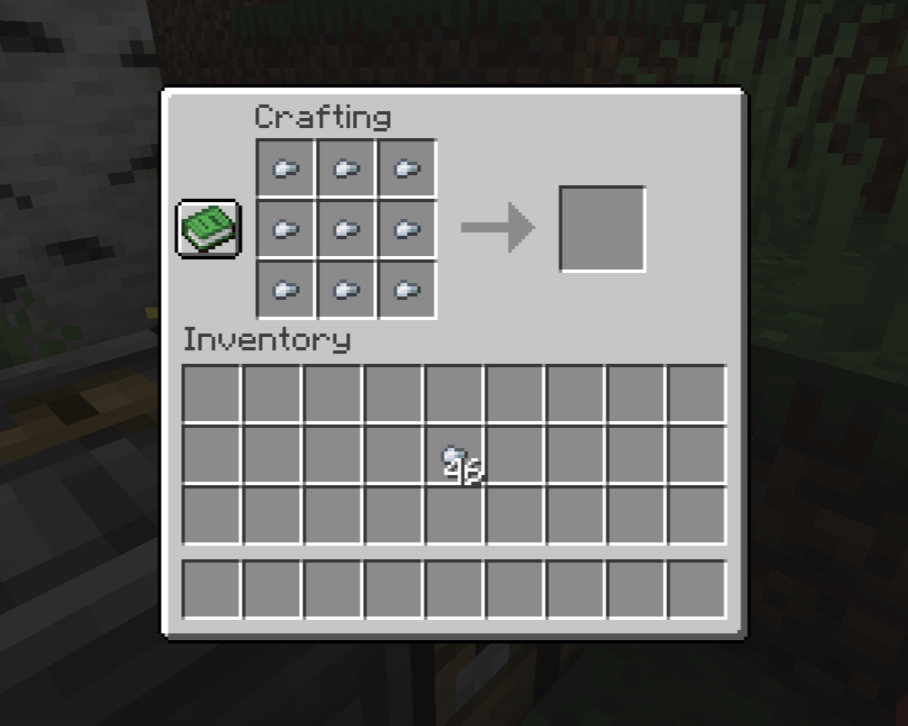

## Restricted Crafting Mod

A server-side mod that restricts **crafting** based on LuckPerms permissions, on **Fabric and NeoForge**.
There are two ways to restrict something.

**By recipe**: deny `restricted-crafting.<recipe_id>`. To stop players crafting iron ingots from nuggets,
set `restricted-crafting.minecraft:iron_ingot_from_nuggets` to `false`. Other recipes for the same item
stay craftable.

**By output item**: deny `restricted-crafting.item.<item_id>`. To stop players crafting an iron ingot by
any recipe at all, set `restricted-crafting.item.minecraft:iron_ingot` to `false`. This covers every current
recipe for that item and every recipe a datapack adds later, so prefer it when the goal is the item rather
than one path to it.

At server startup (and on every datapack `/reload`) the mod registers a permission node for every crafting
recipe and for every item those recipes output, so they all show up in the LuckPerms editor. Use
`/restrictedcrafting dump` to list them, or find recipe ids in
[misode/mcmeta](https://github.com/misode/mcmeta/tree/data-json/data/minecraft/recipe).

Permissions are **fail-open**: a recipe is craftable unless one of its nodes is explicitly denied. Only
crafting-table, inventory-grid and auto-crafter recipes are enforced — smelting, stonecutting, smithing, etc.
are out of scope and intentionally get no nodes, so an item obtainable in a furnace or a stonecutter stays
obtainable there.

Special recipes (firework rocket, map cloning, book cloning, armor dyeing, banner duplicating, ...) build
their result at craft time and declare no output item, so they have no `restricted-crafting.item` node.
Restrict those by recipe id.

### Crafter (auto-crafter)

The Crafter block has no owner, so it follows the `default` LuckPerms group. Both ways of restriction have a crafter
counterpart: deny `restricted-crafting.crafter.<recipe_id>` or `restricted-crafting.crafter.item.<item_id>`
in the `default` group to stop the Crafter making it. The nodes are read on every craft, so a permission
change applies at once, and group inheritance is resolved.

Denying a recipe for a player does **not** stop a Crafter making it. Deny the matching
`restricted-crafting.crafter.*` node as well, or players can place a Crafter to get around the
restriction.

### Commands

- `/restrictedcrafting dump [file]` — write two tables to a file in the server directory (default
  `restricted-crafting-permissions.txt`): 
  - Every permission node with its current default-group state 
  - Every crafting recipe listed with the item it outputs (`<output_item>\t<recipe_id>`).  

The second table is how you find the other recipes that make an item you are restricting. Requires op level 4.

### Supported versions

- **Fabric:** 1.21 – 1.21.11, 26.1+
- **NeoForge:** 1.21 – 1.21.11, 26.1+

This is a [Stonecutter](https://stonecutter.kikugie.dev/) project: one Mojang-mapped source tree, one node per
Minecraft compatibility bucket. `./gradlew build` builds every node.

[CurseForge](https://legacy.curseforge.com/minecraft/mc-mods/restricted-crafting),
[Modrinth](https://modrinth.com/mod/restricted-crafting), [Discord](https://discord.gg/UY4nhvUzaK)

### Dependencies

- **LuckPerms** — [website](https://luckperms.net/), [Modrinth](https://modrinth.com/mod/luckperms) (required, both loaders)
- **Fabric API** — [Modrinth](https://modrinth.com/mod/fabric-api) (Fabric only)
